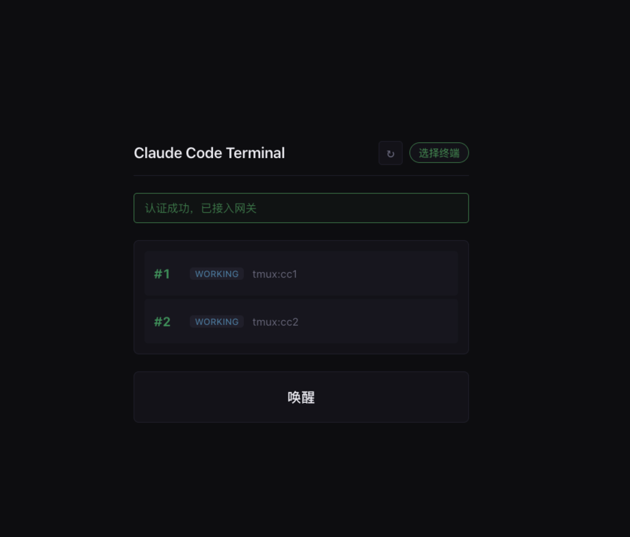
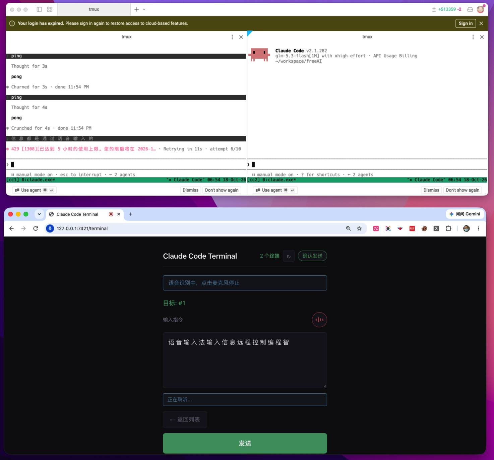

# AgentRemote

AgentRemote 是一个开源的本地 Claude Code 多实例控制网关。它通过 Claude Code Hooks 收集各个 Claude Code 会话状态，在浏览器 Web 终端中选择目标终端，并把文本安全地注入对应的 tmux 会话。

## 界面预览

配对码认证后，浏览器里可以直接看到所有 tmux 会话的实时状态，并通过语音或文字向指定终端发送指令：



Web 终端（下方）通过网关同时驱动两个 tmux 中的 Claude Code 会话（上方 `cc1` / `cc2`），并支持语音识别输入：



## 核心能力

- 接收 Claude Code Hook 事件，归一化为 `WORKING`、`AWAITING_CONFIRMATION`、`DONE`、`ERROR` 状态
- 为最多 8 个 Claude Code 会话分配稳定的 `#1` 至 `#8` 编号
- 提供内置 Web 控制端：`/terminal`
- 使用 WebSocket 实时推送会话快照和状态增量
- 使用六位配对码完成设备配对，认证后才能发送指令
- 通过 tmux literal mode 注入文本，不经过 shell，不拼接命令字符串
- 多行输入只发送第一行，并在确认消息中返回 `MULTILINE_TRUNCATED`
- 内置 49 个单元与集成测试

## 快速开始

### 1. 安装依赖

```sh
cd gateway
python3 -m venv .venv
.venv/bin/pip install -r requirements.txt
```

如果要运行测试：

```sh
.venv/bin/pip install -r requirements-dev.txt
```

### 2. 启动 tmux 会话

网关通过 `cc_code -> tmux session` 映射注入文本。示例：

```sh
tmux new -s cc1 'claude'
tmux new -s cc2 'claude'
```

启动网关时指定映射：

```sh
CC_COMPANION_TMUX_TARGETS='1=cc1,2=cc2' .venv/bin/python app.py
```

网关默认监听 `http://127.0.0.1:7421`，并在终端输出六位配对码。

### 3. 接入 Claude Code Hooks

将 `cc-integration/settings.example.json` 中的 Hook 配置复制到 Claude Code 设置，并把 `/absolute/path/to` 替换为本仓库的绝对路径。

Hook 脚本默认发送到：

```text
http://127.0.0.1:7421/hook
```

网关不可用时 Hook 会静默返回成功，不会阻塞 Claude Code。

### 4. 使用 Web 终端

打开：

```text
http://127.0.0.1:7421/terminal
```

流程：

1. 点击 **唤醒**
2. 首次使用输入网关终端显示的六位配对码
3. 点击数字键选择目标 Claude Code 终端
4. 输入指令
5. 点击发送或按 `Command/Ctrl + Enter`

## 配置

| 环境变量 | 默认值 | 说明 |
|---|---:|---|
| `CC_COMPANION_HOST` | `127.0.0.1` | HTTP/WebSocket 监听地址 |
| `CC_COMPANION_PORT` | `7421` | HTTP/WebSocket 监听端口 |
| `CC_COMPANION_MAX_SESSIONS` | `8` | 最多跟踪的 Claude Code 会话数 |
| `CC_COMPANION_SESSION_EXPIRY` | `1800` | 会话过期秒数 |
| `CC_COMPANION_TMUX_TARGETS` | 空 | `cc_code=tmux_session` 映射 |
| `CC_COMPANION_PAIRING_STORE` | `.cc-companion-pairings.json` | token 哈希存储路径 |
| `CC_COMPANION_PAIRING_CODE` | 随机 | 固定六位配对码 |
| `CC_COMPANION_PAIRING_EXPIRY` | `600` | 配对码有效期秒数 |
| `CC_COMPANION_REQUIRE_PAIRING` | `true` | 是否强制配对认证 |

生产使用建议把 `CC_COMPANION_PAIRING_STORE` 放在仓库外。网关只保存 token 哈希，不保存原始 token。

## 测试

```sh
cd gateway
.venv/bin/python -m unittest discover -s tests
```

## 目录结构

```text
gateway/
  access/       设备接入、认证和动作分发
  adapters/     HTTP、WebSocket、Hook、tmux 适配器
  domain/       会话状态与归一化逻辑
  protocol/     WebSocket 协议校验
  tests/        单元与集成测试
  voice-terminal/  Web 控制端静态资源
cc-integration/
  hook.py       Claude Code Hook 转发脚本
```

## 安全说明

- 默认只监听 `127.0.0.1`，不自动暴露到公网
- Web 终端必须先完成配对码认证
- tmux 注入使用参数数组和 literal mode，不调用 shell
- 多行文本会被截断为第一行，避免意外注入多条命令
- 配对码有效期默认 10 分钟
- token 只在本地保存哈希

## License

MIT
